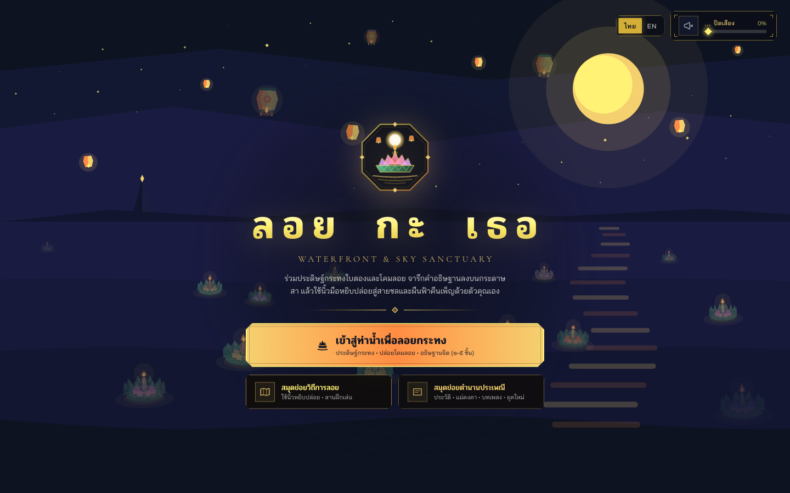
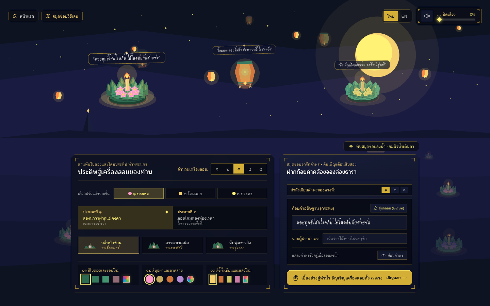
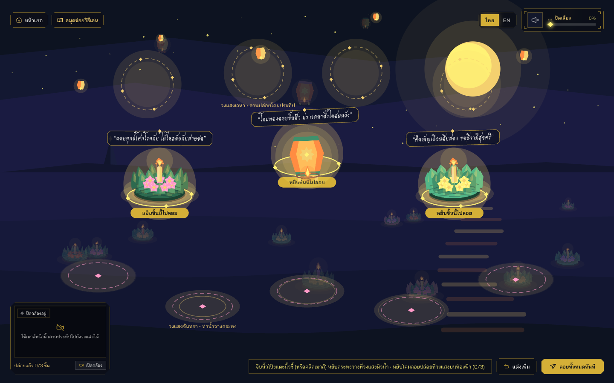
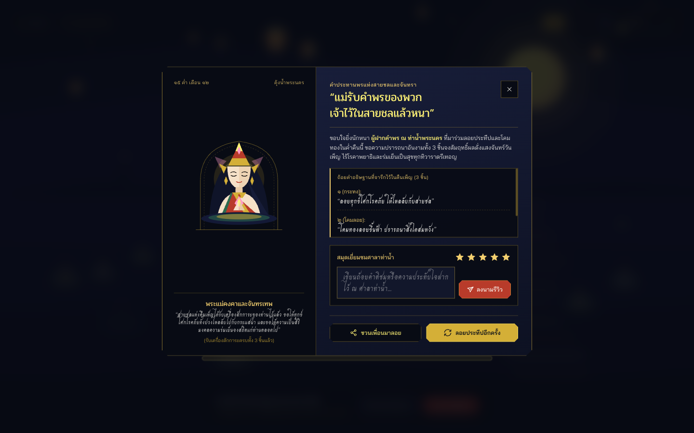
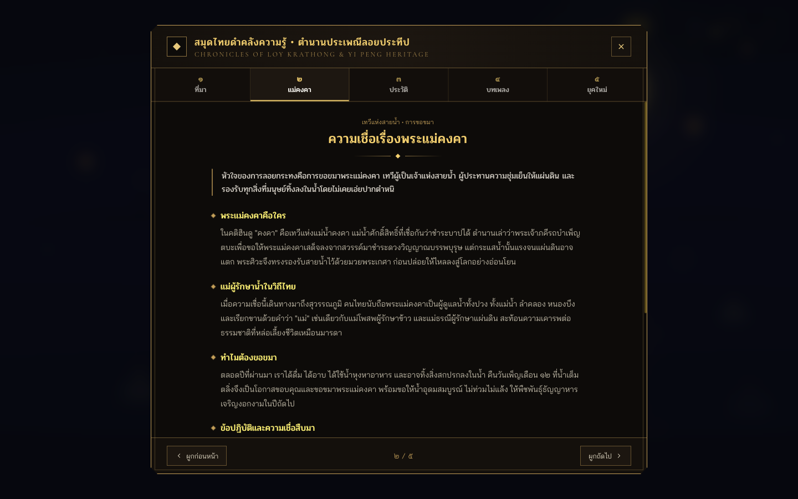
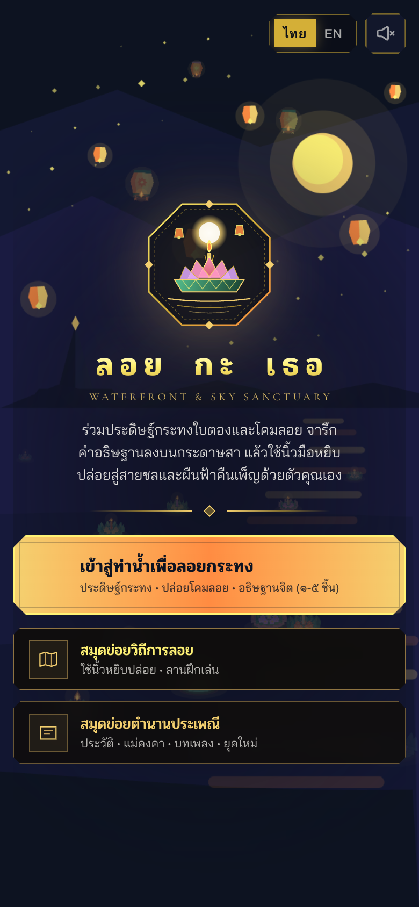

# ลอย กะ เธอ (Loy Kra Ter)

เว็บลอยกระทงออนไลน์ที่ให้คุณ **ใช้นิ้วมือจริงหน้ากล้องเว็บแคม** หยิบกระทงลงสายน้ำและปล่อยโคมลอยขึ้นฟ้า แทนการกรอกฟอร์มแล้วกดส่ง
เปลี่ยนเว็บลอยกระทงให้กลายเป็นประสบการณ์เชิงพิธีกรรมยามค่ำคืน ที่เล่นคนเดียวหรือเล่นพร้อมคนข้างกายในจอเดียวกันได้


---

## Demo / Screenshots

> **Live Demo:** ยังไม่ได้ deploy สามารถรันบนเครื่องได้ทันทีตามขั้นตอนใน [Getting Started](#getting-started)

| หน้าแรก | ประดิษฐ์กระทงและเขียนคำอธิษฐาน |
| --- | --- |
|  |  |

| ท่าน้ำ: หยิบกระทงไปวางในวงแสง | พรจากพระแม่คงคาเมื่อลอยครบ |
| --- | --- |
|  |  |

| สมุดข่อยตำนานประเพณี | บนมือถือ |
| --- | --- |
|  |  |

---

## Features

- **หยิบด้วยนิ้วมือจริง (AI Hand Tracking):** ตรวจจับมือผ่านกล้องเว็บแคมด้วย MediaPipe จีบนิ้วโป้งแตะนิ้วชี้เพื่อหยิบ ลากไปยังวงแสง แล้วคลายนิ้วเพื่อปล่อย รองรับหลายมือพร้อมกัน
- **เล่นได้ทุกอุปกรณ์:** ไม่สะดวกเปิดกล้องก็ใช้เมาส์หรือแตะลากบนจอสัมผัสได้ทันที หน้าจอปรับตามขนาดตั้งแต่มือถือ แท็บเล็ต จนถึงจอใหญ่
- **ประดิษฐ์เครื่องลอยได้ ๑-๕ ชิ้น:** เลือกเป็นกระทงหรือโคมลอย 3 ทรงกลีบใบตอง ผสมสีจากถาดสีไทย ๑๖ คู่ หลอดไล่เฉดสี หรือหลอดดูดสีจากหน้าจอ
- **คำอธิษฐานคล้องจอง:** สุ่มกลอนมงคล ๒๔ บท เขียนเองได้ และเลือกซ่อนคำพรไว้เป็นความลับได้
- **พรจากพระแม่คงคา:** เมื่อปล่อยครบทุกชิ้น จะได้รับโปสการ์ดอวยพร สมุดเยี่ยมชม และปุ่มชวนเพื่อนมาลอย
- **สมุดข่อยวิธีเล่น:** คู่มือการใช้มือพร้อมลานฝึกให้ลองจีบนิ้วหยิบกระทงก่อนลงสนามจริง
- **สมุดข่อยตำนานประเพณี:** ๕ ผูก ว่าด้วยที่มาของลอยกระทง ความเชื่อเรื่องพระแม่คงคา ประวัติในสยาม เพลงรำวงวันลอยกระทงของสุนทราภรณ์ และลอยกระทงในวัฒนธรรมสมัยนิยม
- **2 ภาษา:** ไทย (ค่าเริ่มต้น) และอังกฤษ จำภาษาที่เลือกไว้ให้ครั้งถัดไป
- **ลอยร่วมกันแบบเรียลไทม์:** ซิงก์กระทงของทุกคนผ่าน Firebase Realtime Database หรือใช้ `BroadcastChannel` ระหว่างแท็บเมื่อไม่ได้ตั้งค่า Firebase
- **กราฟิกวาดด้วยโค้ดทั้งหมด:** ฉาก กระทง โคมลอย และภาพพระแม่คงคาวาดด้วย Canvas 2D และ SVG ไม่ใช้ไฟล์รูปภาพ

---

## Tech Stack (Built With)

| ด้าน | เทคโนโลยี |
| --- | --- |
| Framework | [Next.js 16](https://nextjs.org/) (App Router), [React 19](https://react.dev/) |
| Language | [TypeScript](https://www.typescriptlang.org/) |
| Styling | [Tailwind CSS v4](https://tailwindcss.com/), Google Fonts (Pridi, Bai Jamjuree, Charm, Cormorant Garamond) |
| Animation | [Framer Motion](https://motion.dev/), HTML5 Canvas 2D, [canvas-confetti](https://github.com/catdad/canvas-confetti) |
| Computer Vision | [MediaPipe Tasks Vision](https://ai.google.dev/edge/mediapipe/solutions/vision/hand_landmarker) (`HandLandmarker`) |
| Realtime | [Firebase Realtime Database](https://firebase.google.com/docs/database) |
| Icons | [Iconoir](https://iconoir.com/) |
| Package Manager | [pnpm](https://pnpm.io/) |

---

## Getting Started

### สิ่งที่ต้องมี

- [Node.js](https://nodejs.org/) 20.9 ขึ้นไป
- [pnpm](https://pnpm.io/installation) 10 ขึ้นไป (หรือใช้ `npm` แทนได้)
- เว็บแคม (ไม่บังคับ ถ้าไม่มีใช้เมาส์หรือจอสัมผัสได้)

### 1. Clone Repository

```bash
git clone https://github.com/Tonpai2004/loykrater.git
cd loykrater
```

### 2. Install Dependencies

```bash
pnpm install
```

### 3. Environment Variables

คัดลอกไฟล์ตัวอย่างแล้วใส่ค่าจากโปรเจกต์ Firebase ของคุณ

```bash
cp .env.example .env.local
```

| ตัวแปร | คำอธิบาย |
| --- | --- |
| `NEXT_PUBLIC_FIREBASE_API_KEY` | API key ของ Firebase Web App |
| `NEXT_PUBLIC_FIREBASE_AUTH_DOMAIN` | เช่น `your-project.firebaseapp.com` |
| `NEXT_PUBLIC_FIREBASE_DATABASE_URL` | URL ของ Realtime Database เช่น `https://your-project-default-rtdb.firebaseio.com` |
| `NEXT_PUBLIC_FIREBASE_PROJECT_ID` | Project ID |
| `NEXT_PUBLIC_FIREBASE_STORAGE_BUCKET` | Storage bucket |
| `NEXT_PUBLIC_FIREBASE_MESSAGING_SENDER_ID` | Messaging sender ID |
| `NEXT_PUBLIC_FIREBASE_APP_ID` | App ID |

> **ไม่บังคับ:** ถ้าไม่ได้ตั้งค่า Firebase เว็บยังเล่นได้ครบทุกอย่าง แต่กระทงจะแชร์กันได้เฉพาะระหว่างแท็บในเบราว์เซอร์เดียวกัน (ผ่าน `BroadcastChannel`) แทนการซิงก์ข้ามเครื่อง

### 4. Run Development Server

```bash
pnpm dev
```

เปิด [http://localhost:3000](http://localhost:3000) แล้วกด "เข้าสู่ท่าน้ำเพื่อลอยกระทง"

> เบราว์เซอร์อนุญาตให้ใช้กล้องเฉพาะบน `localhost` หรือ `https://` เท่านั้น ถ้าเปิดผ่าน IP ในวง LAN กล้องจะไม่ทำงาน แต่ยังเล่นด้วยเมาส์หรือจอสัมผัสได้

### คำสั่งอื่น ๆ

| คำสั่ง | หน้าที่ |
| --- | --- |
| `pnpm build` | build สำหรับ production |
| `pnpm start` | รัน production server หลัง build |
| `pnpm lint` | ตรวจโค้ดด้วย ESLint |

---

## วิธีเล่น

1. **เข้าสู่ท่าน้ำ:** เลือกจำนวนเครื่องลอย ๑-๕ ชิ้น ปรับแต่งทรงและสี แล้วเขียนหรือสุ่มคำอธิษฐาน
2. **ยกมือหน้ากล้อง:** จะมี "มือทิพย์สีทอง" ขยับตามมือของคุณ เลื่อนไปที่กระทงหรือโคมที่มีวงแสง
3. **จีบนิ้วโป้งแตะนิ้วชี้ค้างไว้:** เพื่อหยิบ แล้วพากระทงลงไปยังวงแสงบนผิวน้ำ หรือพาโคมขึ้นไปยังวงแสงบนฟ้า
4. **คลายนิ้วในวงแสง:** เพื่อปล่อย เมื่อปล่อยครบทุกชิ้น ทุกชิ้นจะลอยออกไปพร้อมกัน และพระแม่คงคาจะปรากฏมาประทานพร

---

## แนวคิดและสถาปัตยกรรม

### แนวคิดการออกแบบ

- **Physicality in Digital Ritual:** เชื่อมการเคลื่อนไหวของร่างกายเข้ากับวัตถุดิจิทัล กระทงจะสัมผัสผิวน้ำก็ต่อเมื่อผู้เล่นคลายนิ้วออกเอง
- **Contemporary Phra Nakhon Aesthetics:** กรอบตัดเหลี่ยมย่อมุม (`.thai-chamfer`) โทนเครื่องรักสีครามตัดทองเหลือง และสมุดไทยดำลงรักปิดทอง
- **Pure Procedural 2D:** ฉากยามราตรี กระทง ๓ ทรง โคมลอยล้านนา และภาพพระแม่คงคา วาดด้วยโค้ดทั้งหมด

### ลำดับสถานะของแอป

`HOME` (หน้าแรก) → `CUSTOMIZE` (ประดิษฐ์เครื่องลอย) → `INTERACT` (หยิบปล่อยที่ท่าน้ำ) → `FLOATING` (ลอยออกไปและรับพร)

### ประสิทธิภาพและการออกแบบระบบ

- **60 FPS ด้วย Offscreen Sprite Cache:** กระทงและโคมถูกวาดครั้งเดียวลง Offscreen `<canvas>` แล้วเก็บใน `Map` ตามสีและทรง ลูปหลักจึงใช้แค่ `drawImage` ร่วมกับเปลวเทียนที่ไหวตามเวลาจริง
- **แยกพิกัดมือออกจาก React render:** พิกัดมือ 60 ครั้งต่อวินาทีเก็บใน `gestureRef` ให้ Canvas อ่านตรง ส่วน state ของ UI อัปเดตเฉพาะตอนสถานะสำคัญเปลี่ยน
- **Hysteresis ของการจีบนิ้ว:** ใช้ระยะหยิบและระยะปล่อยต่างกัน ป้องกันกระทงหลุดมือเพราะมือสั่น
- **ขนาดฉากตามจอ:** กระทง โคม และวงแสงย่อขยายตามขนาดจอ และจัดวงแสงแบบสลับฟันปลาบนจอแนวตั้ง
- **Realtime + Fallback:** ดึงกระทงล่าสุด 35 ชิ้นจาก Firebase (`limitToLast(35)`) และสลับไปใช้ `BroadcastChannel` อัตโนมัติเมื่อไม่มี Firebase

### โครงสร้างโปรเจกต์

```text
loykrater/
├── docs/screenshots/              # ภาพประกอบ README
├── public/audio/                  # เพลงบรรเลงประกอบ
└── src/
    ├── app/
    │   ├── layout.tsx             # ฟอนต์ metadata และ LanguageProvider
    │   ├── page.tsx               # หน้าหลัก ควบคุมสถานะของแอป
    │   ├── globals.css            # ตัวแปรสี ฟอนต์ กรอบย่อมุม และ scrollbar
    │   ├── icon.svg               # ไอคอนพระจันทร์บนแท็บเบราว์เซอร์
    │   └── apple-icon.tsx         # ไอคอนสำหรับหน้าจอโฮม iOS
    ├── components/
    │   ├── home/                  # หน้าแรกและโลโก้
    │   ├── modals/                # สมุดข่อยวิธีเล่น ลานฝึก ตำนานประเพณี และพรพระแม่คงคา
    │   ├── navigation/            # แถบด้านบน (หน้าแรก วิธีเล่น ภาษา เสียง)
    │   ├── CustomizationPanel.tsx # แผงประดิษฐ์เครื่องลอยและคำอธิษฐาน
    │   ├── RiverCanvas.tsx        # ลูปวาดฉาก ฟิสิกส์การหยิบปล่อย 60 FPS
    │   ├── HandTrackerHUD.tsx     # ภาพกล้อง สถานะมือ และปุ่มที่ท่าน้ำ
    │   └── AudioVolumeController.tsx
    ├── constants/
    │   ├── translations.ts        # ข้อความ 2 ภาษาและกลอนมงคล ๒๔ บท
    │   ├── loreContent.ts         # เนื้อหาสมุดข่อยตำนานประเพณี ๕ ผูก
    │   └── krathongDefaults.ts    # ค่าเริ่มต้นของเครื่องลอยและเวลาต่าง ๆ
    ├── contexts/LanguageContext.tsx
    ├── hooks/useHandTracking.ts   # กล้อง MediaPipe และการคำนวณท่าจีบนิ้ว
    ├── lib/
    │   ├── canvasRenderer.ts      # ฟังก์ชันวาดกราฟิก 2D และ sprite cache
    │   └── firebase.ts            # Firebase Realtime Database และ BroadcastChannel
    └── types/krathong.ts          # TypeScript types ทั้งหมด
```

---

## License

เผยแพร่ภายใต้ [MIT License](LICENSE) นำไปใช้ ดัดแปลง และต่อยอดได้ฟรี เพียงคงเครดิตผู้สร้างเดิมไว้

เพลงประกอบใน `public/audio/` และเนื้อเพลงที่กล่าวถึงในสมุดข่อย เป็นลิขสิทธิ์ของเจ้าของผลงาน ไม่รวมอยู่ใน MIT License

---

พัฒนาและออกแบบโดย **[Tonpai](https://github.com/Tonpai2004) Madampong Prueksa**
